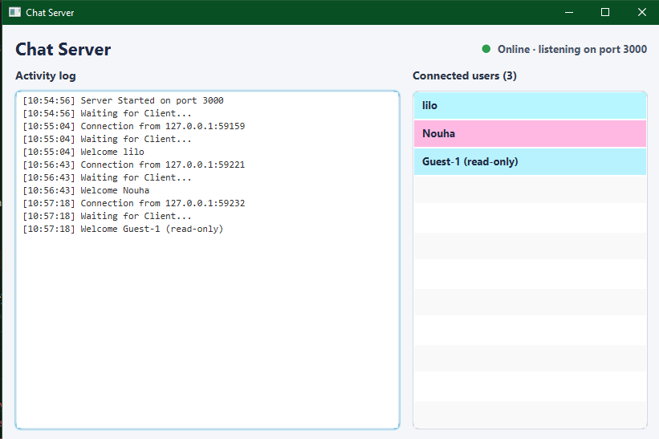
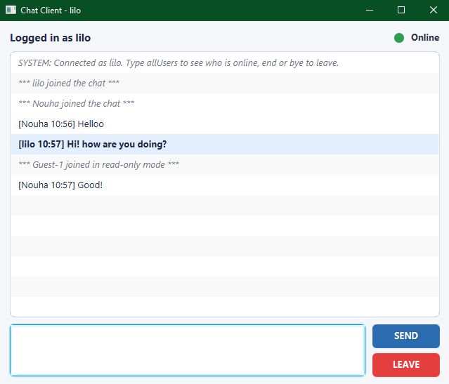
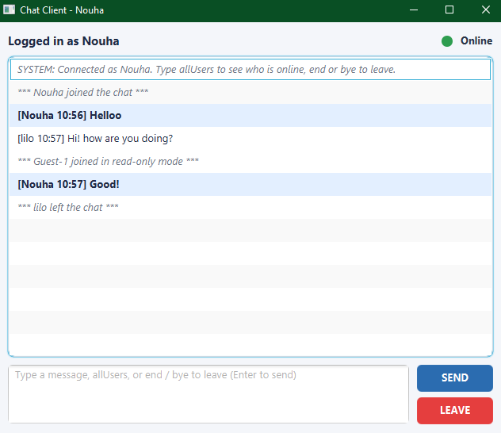
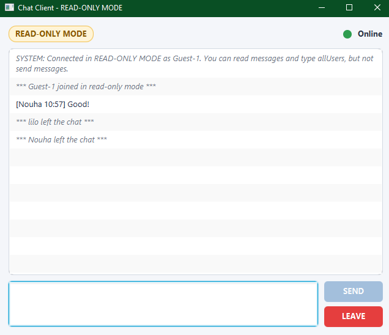

# Multi-Client Chat Application — Java Sockets (TCP) + JavaFX

Project 1 — Advanced Distributed Programming (Pr. El Habib Nfaoui)

A group chat in which one **TCPServer** relays messages between many **TCPClient** applications over TCP sockets. The server handles every client on its own **virtual thread**, and both programs have a **JavaFX** interface (GridPane + CSS).

## Features

**Client**
- Username screen before the chat. An empty username joins in **READ-ONLY MODE**, which lets you read messages but not send them.
- Send with the **SEND** button or the **Enter** key. Shift+Enter inserts a new line.
- `allUsers` asks the server for the list of active users, and the reply goes only to you.
- `end`, `bye` or the **LEAVE** button disconnects and notifies the server.
- **Online** status label with a green circle, which turns grey and reads **Offline** after disconnecting.

**Server**
- Accepts any number of concurrent clients, one virtual thread each.
- Formats every message as `[username HH:mm] text` and broadcasts it to all connections.
- Live **ListView** of connected users, each with a random background colour.
- Activity log with entries such as "Server Started", "Waiting for Client...", "Welcome alice" and "alice left the chat".

## Project structure

```
chat-project/
├── TCPServer/                         Maven project
│   ├── pom.xml
│   └── src/main/
│       ├── java/
│       │   ├── TCPServer.java         entry point (java TCPServer)
│       │   └── ma/aui/chat/server/
│       │       ├── config/ServerConfig.java     loads config.properties
│       │       ├── model/ChatServer.java        ServerSocket, accept loop, broadcast
│       │       ├── model/ClientHandler.java     one per client, runs on a virtual thread
│       │       ├── model/ServerListener.java    model -> view callbacks
│       │       └── view/ServerApp.java          JavaFX UI (log + user list)
│       └── resources/config.properties, server.css
├── TCPClient/                         Maven project
│   ├── pom.xml
│   └── src/main/
│       ├── java/
│       │   ├── TCPClient.java         entry point (java TCPClient <ip> <port>)
│       │   └── ma/aui/chat/client/
│       │       ├── config/ClientConfig.java     args > config.properties
│       │       ├── model/ChatClient.java        Socket, send, receive thread
│       │       ├── model/MessageListener.java   model -> view callbacks
│       │       └── view/ClientApp.java          JavaFX UI (login + chat)
│       └── resources/config.properties, client.css
└── docs/                              UML diagrams (PlantUML sources)
```

## Model–View separation

The `model` packages import **no JavaFX classes**. Each model reports events through a small interface (`ServerListener` on the server, `MessageListener` on the client), and the JavaFX view implements that interface. Because model callbacks arrive on background threads, the view wraps every UI change in `Platform.runLater`.

As a result, the whole networking layer can run without any UI. It has been tested headlessly with a console listener, covering 3 clients, broadcasting, read-only mode, `allUsers` and leaving. Swapping the JavaFX view for another UI would require no change to the model.

## Protocol

Text over TCP, one line per message, UTF-8 encoded.

| Direction | Line | Meaning |
|---|---|---|
| client → server | first line = username (empty → read-only) | join |
| client → server | `allUsers` | list active users (reply to sender only) |
| client → server | `end` / `bye` | leave |
| client → server | any other text | chat message |
| server → client | `[alice 14:05] hello` | broadcast message |
| server → client | `SYSTEM: ...` / `*** ... ***` | notices (join, leave, user list) |

## Configuration

`config.properties` contains the following:

```properties
server.host=localhost
server.port=3000
```

- **Server:** the port is read at runtime from `config.properties`. A copy placed next to `TCPServer.jar` (in the working directory) overrides the built-in default, so the port can change without recompiling.
- **Client:** `java TCPClient <ServerIPAddress> <PortNumber>` takes priority. Without arguments, the client falls back to `config.properties`.

## Requirements

- JDK **21+**, which virtual threads require
- Maven 3.8+ (bundled with IntelliJ IDEA)
- Internet access on the first build, so Maven can download JavaFX

## Build

```bash
cd TCPServer && mvn clean package     # -> TCPServer/target/TCPServer.jar
cd ../TCPClient && mvn clean package  # -> TCPClient/target/TCPClient.jar
```

The JARs are "fat" JARs that bundle JavaFX for the OS you build on. Build them on the same OS family (Windows, macOS or Linux) that you will run them on.

## Run

```bash
# 1. start the server
java -jar TCPServer/target/TCPServer.jar
#    (equivalent: java -cp TCPServer/target/TCPServer.jar TCPServer)

# 2. start as many clients as you want
java -jar TCPClient/target/TCPClient.jar localhost 3000
#    (equivalent: java -cp TCPClient/target/TCPClient.jar TCPClient localhost 3000)
```

During development you can also run `mvn javafx:run` inside each project. In IntelliJ, open each folder as a Maven project and run `TCPServer` / `TCPClient`; for the client, set the program arguments to `localhost 3000`.

**Two machines:** run the server on PC A and find its LAN IP (`ipconfig` / `ifconfig`). On PC B, run `java -jar TCPClient.jar 192.168.x.x 3000`. Allow port 3000 through the firewall on PC A.

## UML

PlantUML sources live in `docs/`. Render them in IntelliJ with the PlantUML plugin or at plantuml.com.

- `class-diagram.puml`: class structure of both projects
- `deployment-diagram.puml`: the server node and client nodes, linked over TCP/IP
- `sequence-diagram.puml`: the join → message → allUsers → leave flow

## Screenshots

### Server


### Client 1


### Client 2


### Client 3
#### (Read only)


## Demo video

https://alakhawayn365-my.sharepoint.com/:f:/g/personal/n_bitar_aui_ma/IgBKaLd0rxb3Qr-SqgLrX6B-Acp595-FrePkANyGUkifR2g?e=SoIzYd

## Authors

Nouha Bitar
